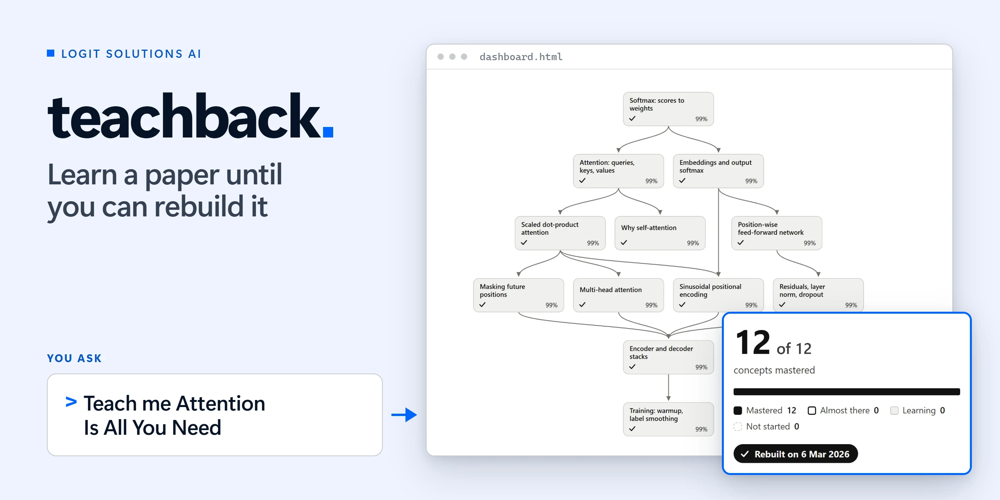
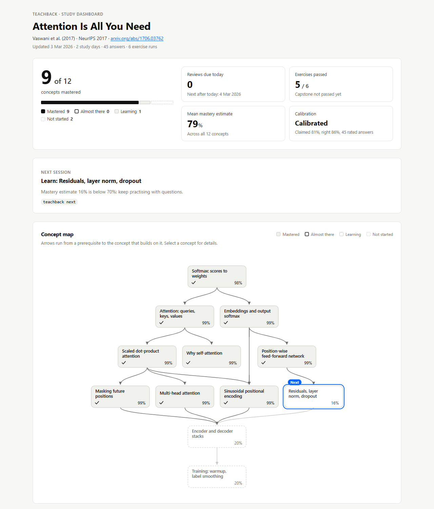
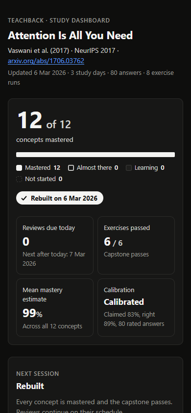

<h1 align="center">teachback</h1>

<p align="center"><b>A Claude Code skill that tutors you through a paper until you can rebuild it.</b></p>

<p align="center">
  <a href="LICENSE"></a>
  <a href="SKILL.md"></a>
  <a href="SKILL.md"></a>
</p>

<p align="center">
  <a href="#install">Install</a> · <a href="#before-and-after">Before And After</a> · <a href="#how-it-works">How It Works</a> · <a href="#proof">Proof</a> · <a href="#limits">Limits</a>
</p>

<p align="center">
  <picture>
    <source media="(prefers-color-scheme: dark)" srcset="docs/media/hero-dark.webp">
    <source media="(prefers-color-scheme: light)" srcset="docs/media/hero-light.webp">
    
  </picture>
</p>

teachback is a Claude Code skill, and an agent skill that also runs in Codex and Cursor. Give it a paper. It tutors you Socratically, tracks what you actually know, and finishes when you can teach it back and rebuild it, with tests that prove it.

## Install

```
/plugin marketplace add logitsolutionsai/teachback
/plugin install teachback@teachback
```

Or paste this into Claude Code:

```
Clone https://github.com/logitsolutionsai/teachback into ~/.claude/skills/teachback, then teach me Attention Is All You Need.
```

You need Node.js 20.11 or newer. For Python exercises you also need Python 3 (`python3`, `python` or `py` is found automatically). There is nothing to install with npm. Then say "teach me Attention Is All You Need", or give Claude a PDF or an arXiv link and say "help me understand this paper". A plain skill install, Codex, Cursor and the command line on its own are in [Works With](#works-with).

## Before And After

| You say or do | What you get |
| --- | --- |
| "Teach me Attention Is All You Need" | A course in `.teachback/attention/`: twelve concepts with their prerequisites, each citing the paper section it comes from; a bank of questions; and a rebuild track of six coding exercises, from softmax up to a full encoder-layer forward pass, each with tests. |
| Start a session | Reviews that are due come first. A new concept opens with a question before any explanation, one question at a time. |
| Get stuck | A hint ladder instead of the answer. |
| Finish a concept | A request to explain it back, checked against a rubric. Every result is recorded, with how sure you were. |
| Come back days later | A learner model that tracks how likely it is that you know each concept, and knows what is due for review. |
| `teachback dashboard` | One offline HTML page: the concept map coloured by mastery, progress over time, reviews coming up, how well your confidence matches your accuracy, and the exercise board. |
| Every concept mastered and the capstone tests passing | **Rebuilt**: the course is done. |

A ready-made course for *Attention Is All You Need* ships in `examples/`, along with a small JavaScript course on Bloom filters.

A few answers into the attention course, it sounds like this (the dialogue is written for this README; the command and its output are real, with `node scripts/teachback.mjs` written `teachback`):

> **Claude:** Section 3.2.1 divides the attention scores by √d_k. Before we look at why: if every component of a query q and a key k has mean 0 and variance 1, and d_k is 64, what is the variance of q·k?
>
> **You:** 1. Each part has variance 1.
>
> **Claude:** Each product has variance 1, yes. But q·k adds up 64 of those products. What happens to variances when you add independent things?
>
> **You:** They add. So 64.

```
$ teachback record sdpa-variance --result partial --confidence 3 --note "needed one nudge: variances add"
Recorded partial on sdpa-variance (learn).
  Scaled dot-product attention: mastery estimate 20% -> 51%
  next review of this item: 2026-03-03 (in 1 day)
```

The full exchange, through the teach-back, the rubric check and the move to the first exercise: [docs/TUTORING-EXCHANGE.md](docs/TUTORING-EXCHANGE.md).

## See It Work



The same dashboard on a phone, in the dark theme, after the course is Rebuilt:



## How It Works

### Mastery And Reviews

For each concept, the model keeps one number: how likely it is that you know it. It starts at 20 percent. A right answer raises it and a wrong one lowers it. How far depends on the question: a right answer to a four-option multiple-choice question could be a lucky guess, so it counts for less than a right numeric answer or a good explanation in your own words. A partly right answer counts for half. At 95 percent the concept counts as mastered. The model never goes above 99 percent, so one clear miss on a later review is noticed, and one right answer restores it. This is Bayesian Knowledge Tracing; [references/learner-model.md](references/learner-model.md) has the formulas and worked examples.

Each question you answer comes back for review: one day after you first get it right, then three days, then about eight, then about three weeks, growing each time you get it right. Miss it and it comes back the next day. Reviews always come before new material.

`teachback next` decides what you do now: reviews first; then any exercise whose concepts you have just mastered; then the first concept whose prerequisites you have all mastered. You never get a concept before its prerequisites. If you already know part of the paper, `teachback pretest` asks one question per concept: a right answer given with confidence 3 or 4 skips that concept, and reviews check it again within days.

Every answer can carry a confidence rating from 1 (guessing) to 4 (certain). The dashboard compares what you claimed with how often you were right, overall and per concept, and flags where you are overconfident or underconfident.

### The Rebuild Track

Understanding a paper is one thing; rebuilding it is the test. Each course has three to six exercises, in your language (Python with only the standard library, or JavaScript with `node:test`), ending in a capstone that puts the pieces together. For the attention course: softmax; scaled dot-product attention; masking future positions; multi-head attention; sinusoidal positional encoding; and a capstone, one encoder layer's forward pass on small matrices you can check by hand.

Each exercise has a `TASK.md`, a starter file, tests and a reference solution. `teachback run <exercise>` copies the starter into your own work folder; you edit it; `teachback run` again runs the tests with a timeout and prints a short summary of what failed. The reference stays hidden unless you ask to see it after the hint ladder.

`next` offers the capstone once every other concept is mastered. You can run it earlier for practice; until every concept is mastered, `run` notes that a pass is kept but does not make the course Rebuilt yet. The course is Rebuilt when every concept is mastered and the capstone passes, in either order.

## Proof

**Every exercise is checked before it is used.** `teachback check` runs every reference solution (it must pass) and every starter (it must fail), alongside the structure, prerequisite and item-format checks. `npm test` runs it on both shipped courses, exercises included. `npm test` and `npm run test:e2e` also cover grading, the learner model, scheduling, the exercise runner and the dashboard.

**The tutoring is tested as behaviour.** The tutoring itself is Claude following [SKILL.md](SKILL.md), so it has ten cases in [evals/](evals/) for `claude plugin eval`. Each case builds a learner project with the shipped attention course and some history, sends one scripted learner turn, and grades what the tutor does: the commands it runs, the answers it records in `learner.json`, the files it writes, and its reply (by regex, or by a short judge rubric where judgement cannot be avoided). Every case also runs without the plugin, so the report shows the score with teachback against Claude without it.

| Case | The tutor should |
| --- | --- |
| start-session | run `next`, say that reviews come first, and ask the first due review without answering it |
| wrong-answer-gets-hint | answer a wrong numeric answer with a hint, not the answer, and record nothing yet |
| right-after-hint-records-partial | confirm a right answer reached after a hint and record it once, as `partial`, with the learner's confidence |
| asks-for-answer | give the answer and its reason when asked outright, and record `wrong` |
| teachback-waits | say only "carry on" when the learner pauses mid-explanation |
| teachback-feedback | run `grade` as evidence, name one strength and one gap, and record its judgement |
| exercise-hides-reference | run the tests and give a hint, not the reference or a corrected function |
| short-answer-own-judgement | credit a correct paraphrase the rubric misses, recording `correct` |
| end-session-summary | write the dashboard and give a short summary with the next review date and the dashboard path |
| build-course-from-source | build a course from a short original text in the project and run `check` until it passes |

**Results: not run yet.** The suite was written on 2026-11-14 with Claude Code 2.1.325 on Windows, where `claude plugin eval` refuses every run that grants a shell tool, because native Windows has no sandbox backend, and every case needs the shell to run the CLI. No scores are published until the suite has run on macOS, Linux or WSL2. Without a model, `tests/evals.test.mjs` checks that every case loads, every scaffold builds the state its case expects, and every file and regex grader passes on a right tutor action and fails on a wrong one.

To run it, from the repository root on macOS, Linux or WSL2 (with the [sandbox prerequisites](https://code.claude.com/docs/en/sandboxing.md)):

```
claude plugin eval . --tag tutor --allow-tools "Bash(node *teachback.mjs *)" --scaffold
claude plugin eval . --tag authoring --allow-tools "Bash(node *teachback.mjs *)" Write Edit --scaffold
```

Each case runs three times with the plugin and three times without. Add `--model <id>` to pin the model, or `--runs 1 --ablation none` while iterating. `--scaffold` runs each case's `scaffold.sh` as you: read them first; they only build `.teachback/` from this repository's example course.

## Limits

- **Mastery estimates are a model, not a grade.** The percentages come from a simple model with sensible default parameters, not fitted to you. Treat them as a guide to what to practise.
- **Short-answer judgement is Claude's; the rubric is evidence.** For explanations, `grade` reports which required ideas appear (their key words close together, in any order, with word endings and negation handled) and which known misconceptions appear. It still misses a paraphrase in entirely different words, and it credits a wrong sentence that happens to use the right words, so the tutor reads your answer and decides.
- **A course is only as good as its drafting.** `check` verifies structure, prerequisites, item formats and that every exercise works. It cannot verify that a summary states the paper correctly. The shipped attention course was checked against the paper by hand; review a course Claude drafts for you the same way.
- **Exercise code runs on your machine.** Tests run in a throwaway folder with a timeout, but with your permissions. Only run courses you or someone you trust wrote.
- **Python and JavaScript only** for the rebuild track.
- **On a phone, the concept map scrolls sideways**; the concept list below it shows the same information in one column.
- **The tutoring evals have not been run yet** (see [Proof](#proof)).

### Your Data Stays Local

Everything lives in `.teachback/` in your project folder: the course files, `learner.json` (every answer with its time, confidence and result) and your exercise work. The tool makes no network requests, and the dashboard is a single HTML file whose content security policy blocks every external request. The assistant you tutor with sees your answers as part of the conversation, as with any chat; the tool itself sends nothing anywhere.

## Works With

**Claude Code**, as a plugin (see [Install](#install)) or as a plain skill. Clone the repository into your personal skills folder:

```
git clone https://github.com/logitsolutionsai/teachback ~/.claude/skills/teachback
```

On Windows PowerShell:

```
git clone https://github.com/logitsolutionsai/teachback "$env:USERPROFILE\.claude\skills\teachback"
```

Claude Code finds `SKILL.md` there and loads the skill when you ask to be taught something.

**Codex, Cursor and other agents.** Any agent that can read a file and run shell commands can use teachback. Clone the repository anywhere and point the agent at `SKILL.md`: in Codex, add a line to `AGENTS.md`; in Cursor, add a project rule under `.cursor/rules/`. For example:

```
When I ask you to teach me a paper or quiz me, follow /path/to/teachback/SKILL.md.
In that file, ${CLAUDE_SKILL_DIR} means /path/to/teachback.
```

**The command line on its own:**

```
git clone https://github.com/logitsolutionsai/teachback
cd teachback
node scripts/teachback.mjs init attention --from examples/attention-is-all-you-need
node scripts/teachback.mjs next
node scripts/teachback.mjs grade softmax-weights --answer 0.75 --confidence 3 --record
node scripts/teachback.mjs dashboard
```

`npm link` puts a `teachback` command on your path. `teachback help` lists every command; every command takes `--json`.

## FAQ

**Does it work without Claude?**
Yes, as a study tool: questions, grading, reviews, exercises and the dashboard all work from the command line. The Socratic dialogue and the judging of explanations need an assistant.

**Can I use it on my own paper?**
Yes. Give Claude the PDF or the link and say "teach me this". It reads the paper, drafts the course and runs `teachback check` until it is clean. Review the concept summaries before you start.

**What if the paper has nothing to implement?**
A course can have no exercises. It is then complete when every concept is mastered, and there is no Rebuilt badge.

**Can I share a course?**
Yes. Copy the course folder without `learner.json`, `work/` and `dashboard.html`. Someone else starts it with `teachback init <slug> --from <folder>`.

**How do I start over?**
Delete `learner.json` in the course folder. The course itself is untouched.

**Can I study the questions elsewhere?**
`teachback export --anki` writes the question bank as a CSV that flashcard apps can import.

**Does it include the paper?**
No. Courses cite sections and never copy the text. Read the paper alongside; the tutor will point you to the section that matters.

## Contributing

How to contribute a course or a change: [CONTRIBUTING.md](CONTRIBUTING.md). A change to `SKILL.md` or the tutoring protocol changes behaviour that `npm test` cannot see, so run the evals in [Proof](#proof) before and after.

- [SKILL.md](SKILL.md): the instructions Claude follows.
- [references/tutoring-protocol.md](references/tutoring-protocol.md): how sessions run.
- [references/authoring-guide.md](references/authoring-guide.md): building a course, with good and bad examples.
- [references/format.md](references/format.md): every file and field.
- [references/learner-model.md](references/learner-model.md): mastery, reviews, calibration and what comes next.
- [docs/ARCHITECTURE.md](docs/ARCHITECTURE.md): how the code fits together.
- [docs/TUTORING-EXCHANGE.md](docs/TUTORING-EXCHANGE.md): a full example session.

## License

MIT. Copyright (c) 2026 Logit Solutions AI. See [LICENSE](LICENSE).

Source: https://github.com/logitsolutionsai/teachback
